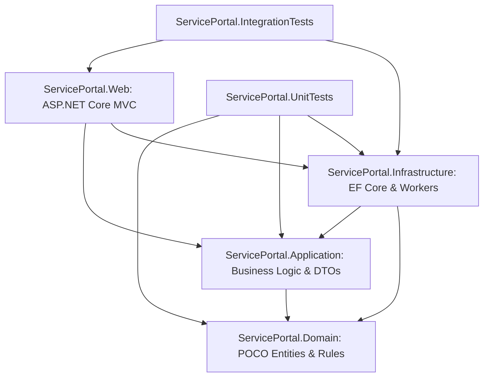

# Smart Service Request Management Portal (SSRMP) - Architecture Document

## 1. System Architecture Overview

The Smart Service Request Management Portal (SSRMP) is engineered following **Clean Architecture** principles and domain-driven separation of concerns. The system is split across four core projects plus automated test suites:

### Project Responsibilities

1. **`ServicePortal.Domain`**:
   - Contains pure POCO entities (`ServiceRequest`, `ApplicationUser`, `SupportTeam`, `Category`, `SlaPolicy`, `RequestComment`, `RequestAttachment`, `RequestStatusHistory`, `AssignmentHistory`, `Notification`, `AuditLog`, `ReferenceSequence`).
   - Domain state machine transition rules in `WorkflowValidator`.
   - Domain enums (`RequestStatus`, `RequestPriority`, `PreferredContactMethod`, `NotificationType`, `ResolutionCategory`, `AppRoles`).
   - Zero dependencies on UI, external services, or infrastructure frameworks.

2. **`ServicePortal.Application`**:
   - Data Transfer Objects (DTOs) for request creation, filtering, dashboard aggregation, and state transitions.
   - Core interfaces (`IServiceRequestService`, `ISlaCalculator`, `IReferenceNumberGenerator`, `IFileStorageService`, `INotificationService`, `IAuditLogService`, `IEmailSender`, `IDashboardService`).
   - Pure business services including `SlaCalculator` (calculating Mon-Fri 09:00 - 18:00 business hours, skipping weekends, and computing breach states).

3. **`ServicePortal.Infrastructure`**:
   - Persistence layer: `ApplicationDbContext` with EF Core Code First mappings, fluent index definitions, and optimistic concurrency token configuration.
   - Background processing:
     - `SlaBreachHostedService`: Proactively polls and detects SLA breaches every 60 seconds, recording audit entries and dispatching notifications.
     - `AutoCloseResolvedHostedService`: Periodically identifies requests in `Resolved` status exceeding 7 calendar days, closes them, and logs automated status history entries.
   - Service implementations:
     - `ReferenceNumberGenerator`: Thread-safe, concurrency-safe sequential generator (`SR-YYYY-NNNNNN`) utilizing optimistic locking with retries.
     - `FileStorageService`: Enforces file extension whitelists, size constraints, and stores attachments securely outside `wwwroot`.
     - `NotificationService`, `AuditLogService`, and `EmailSender` (non-blocking notification dispatch).
     - `DbSeeder`: Automatically creates roles, demo user accounts, initial SLA targets, support teams, categories, and realistic sample service requests.

4. **`ServicePortal.Web`**:
   - ASP.NET Core MVC presentation layer with Razor views.
   - Custom controllers: `AccountController`, `DashboardController`, `ServiceRequestController`, `AdminController`, `NotificationsController`, `HomeController`.
   - Middleware:
     - `CorrelationIdMiddleware`: Generates/propagates `X-Correlation-Id` for structured logging and error traceability (AC-11).
     - `UserActiveCheckMiddleware`: Enforces instantaneous sign-out for deactivated accounts (Section 6.1).
   - Global exception handling and anti-forgery protection.

---

## 2. Authentication and Authorization Design

### Role-Based Access Control (RBAC) & Scope Boundaries

| Role | Access Scope | Enforced Authorization Policies |
|---|---|---|
| **Requester** | Own requests only | IDOR defense: server-side query filter `Where(r => r.RequesterId == currentUserId)`. Internal comments stripped (`IsInternal == false`). Restricted from assignment and direct status manipulation. |
| **Support Agent** | Assigned requests & Team category requests | Can view assigned tickets and team unassigned queue; can transition assigned requests to `InProgress`, request info, resolve, and author internal/public comments. |
| **Team Lead** | Team-wide requests | Can triage, reassign requests among active agents in their team, reopen/escalate, and monitor team SLA compliance and workload metrics. |
| **Administrator** | Full system access | Manage user accounts, activation states, roles, teams, categories, SLA policies, post-closure correction notes, and audit logs. |

### Security Measures Implemented
- **IDOR Defense (AC-02)**: Direct object reference vulnerabilities are prevented through server-side ownership verification in `ServiceRequestService.GetByIdAsync` and `SearchRequestsAsync`.
- **Internal Comment Isolation (AC-03)**: Comments flagged `IsInternal = true` are filtered out in both the details view DTO, CSV export generation, and API responses whenever accessed by a Requester.
- **CSRF Defense**: All state-changing operations are annotated with `[ValidateAntiForgeryToken]` and verified via ASP.NET Core anti-forgery tokens.
- **Account Lockout & Deactivation**: Repeated failed logins trigger Identity lockout. Deactivated accounts are denied access immediately via middleware.

---

## 3. SLA Calculation & Business Hours Engine

Contoso Support Services enforces a business hour schedule:
- **Operating Hours**: Monday through Friday, 09:00 to 18:00 (9 business hours per day).
- **Weekend Exclusion**: Saturdays and Sundays are excluded from SLA calculations.
- **Roll-forward Logic**:
  - If a request is submitted before 09:00 on a weekday, the calculation snaps to 09:00.
  - If submitted after 18:00 or during a weekend, the start time rolls forward to 09:00 on the next business day.
  - Consumed hours are calculated day-by-day until the full target is allocated.

### Priority SLA Targets:
- **Critical**: 1h Response Due, 4h Resolution Due
- **High**: 4h Response Due, 8h Resolution Due
- **Medium**: 8h Response Due, 24h Resolution Due
- **Low**: 48h Response Due, 96h Resolution Due

---

## 4. Background Processing & Resilience

1. **`SlaBreachHostedService`**:
   - Executes every 60 seconds as an `IHostedService`.
   - Scopes `ApplicationDbContext` to query active tickets where `ResolutionDueAt < DateTime.UtcNow` and `!IsSlaBreached`.
   - Updates `IsSlaBreached = true`, sets `SlaBreachedAt = DateTime.UtcNow`, logs structured audit entries, and creates notifications for assignees and team leads.

2. **`AutoCloseResolvedHostedService`**:
   - Executes periodically to detect tickets in `Resolved` status where `ResolvedAt <= DateTime.UtcNow.AddDays(-7)`.
   - Automatically transitions status to `Closed`, updates `ClosedAt`, and appends an automated `RequestStatusHistory` entry without manual intervention.

---

## 5. Concurrency Management (AC-10)

- Every `ServiceRequest` and `ReferenceSequence` carries a `RowVersion` concurrency token.
- `ApplicationDbContext` automatically updates the concurrency token on state modifications.
- If two users submit status updates concurrently, the second submitter is blocked with a clear concurrency conflict message (`"The request was modified by another user concurrently. Please reload and review the latest changes."`).
