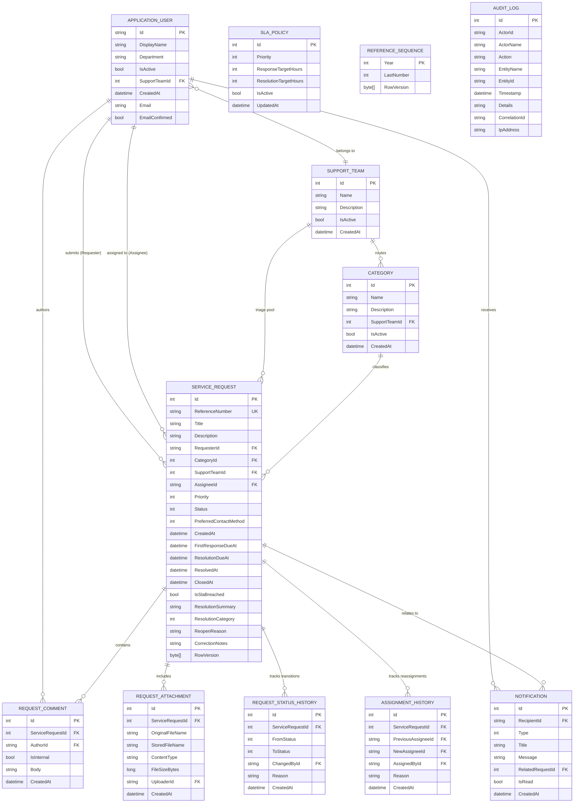

# Smart Service Request Management Portal (SSRMP) - Entity-Relationship Diagram

## Entity-Relationship Diagram (Mermaid)

## Modeling Decisions & Indexing
1. **Concurrency Tokens**: `ServiceRequest.RowVersion` and `ReferenceSequence.RowVersion` are marked as concurrency tokens.
2. **Indexes**:
   - `ServiceRequests.ReferenceNumber` (Unique Index)
   - `ServiceRequests.Status`, `Priority`, `CategoryId`, `AssigneeId`, `RequesterId`, `CreatedAt`, `ResolutionDueAt`, `IsSlaBreached`
   - `AuditLogs.Timestamp`, `CorrelationId`, `[EntityName, EntityId]`
   - `Notifications.[RecipientId, IsRead]`
3. **Delete Behaviors**:
   - `ServiceRequest` deletions cascade to `RequestComment`, `RequestAttachment`, and `RequestStatusHistory`.
   - `ApplicationUser` delete is `Restrict` on tickets and comments to preserve full audit trails.
